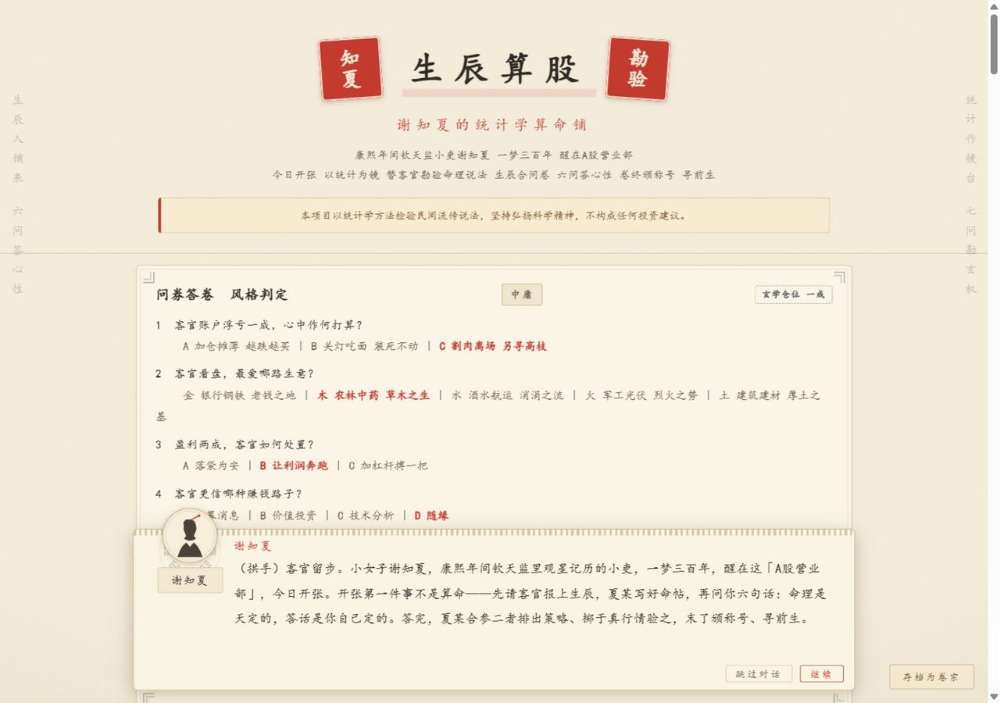
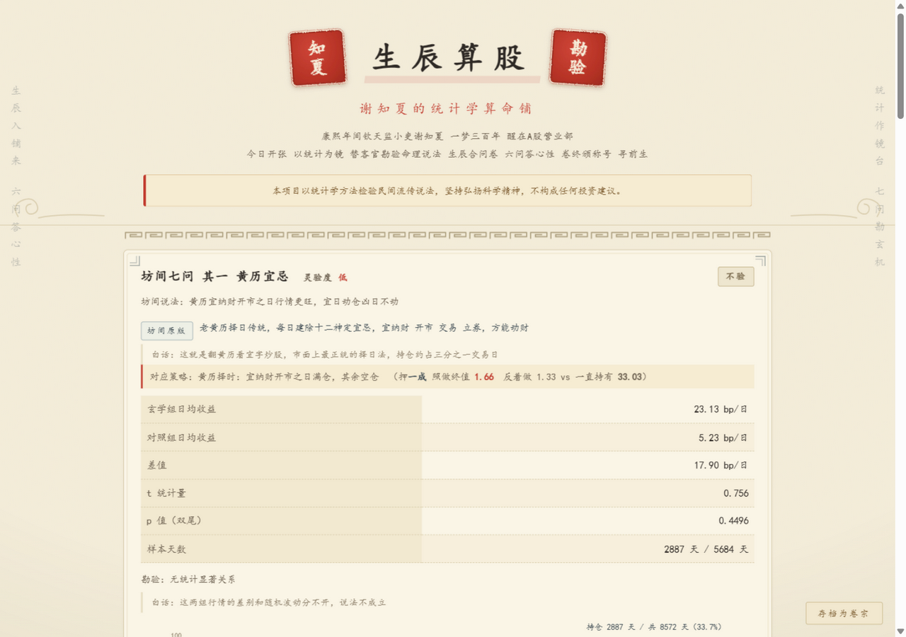
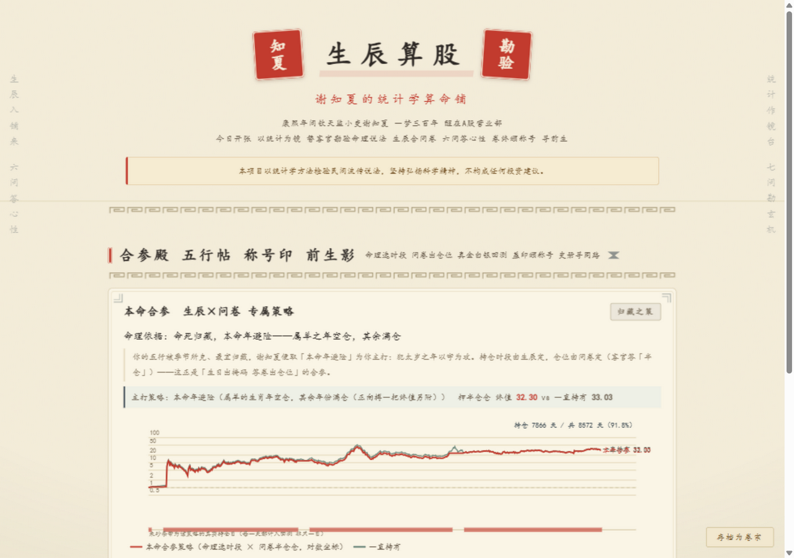
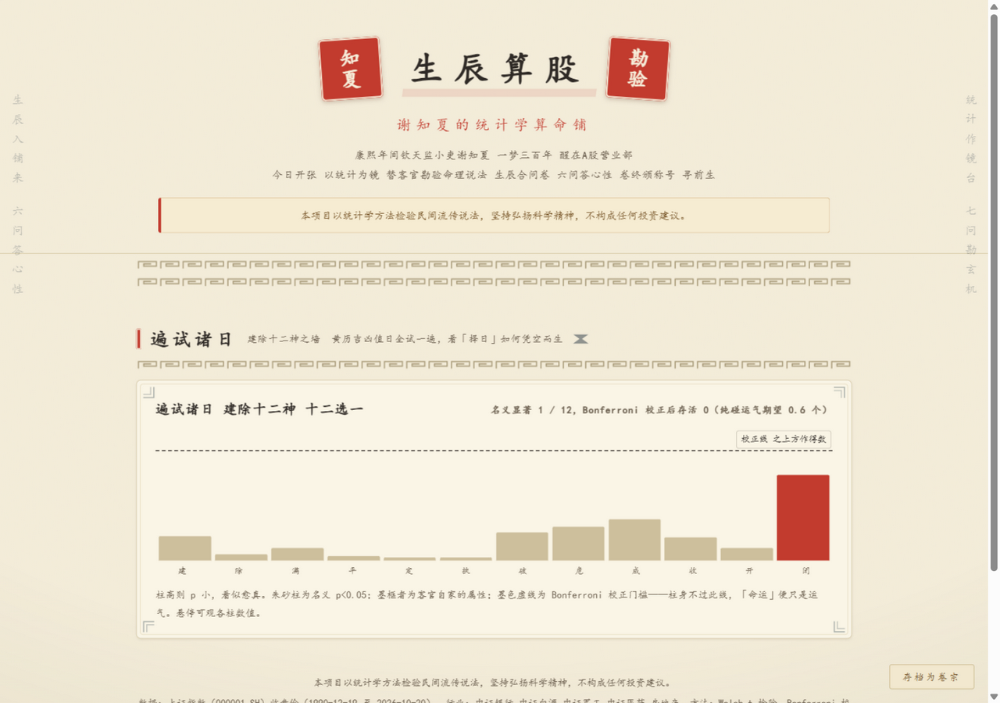
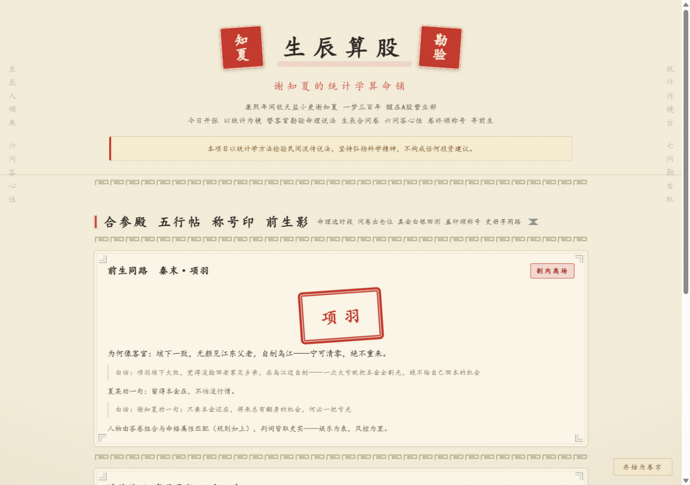
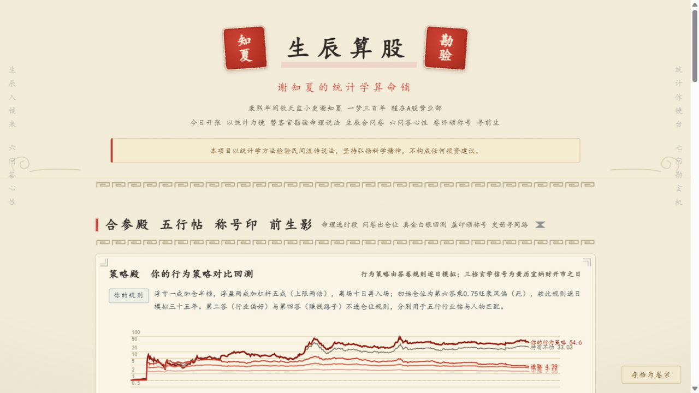
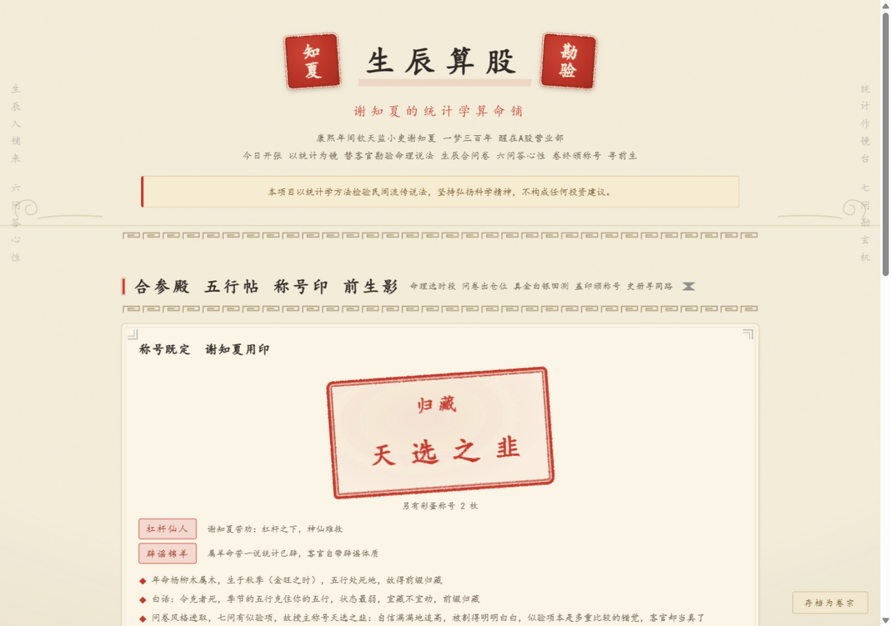
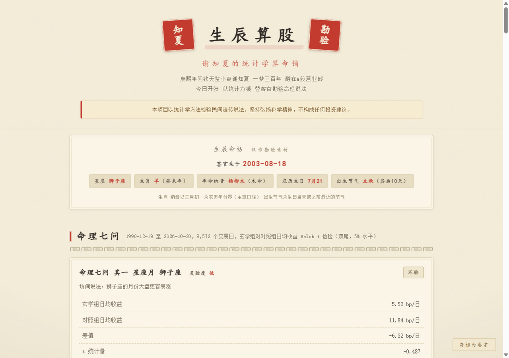
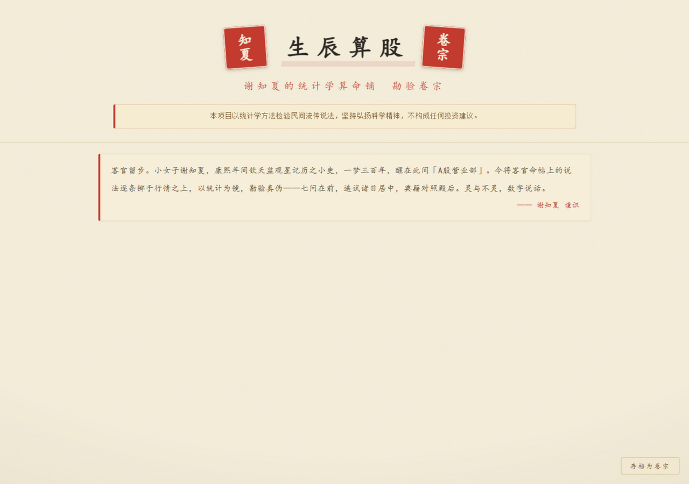

# 生辰算股 谢知夏的统计学算命铺

> **不是算命，是辟谣。**

> 本项目以统计学方法检验民间流传说法，坚持弘扬科学精神，不构成任何投资建议。

康熙年间钦天监小吏**谢知夏**，一梦三百年，醒在 A 股营业部。她开了一间统计学算命铺：输入生辰答她六问，她把**市面上最通行的玄学炒股说法**，黄历宜忌、水星逆行、满月效应、本命年避险、节气变盘、数字禁忌、三合流年，逐条掷到**上证指数 1990 年至今 8,500+ 个真实交易日**面前，用 Welch t 检验 + Bonferroni 多重比较校正给出裁决：**玄学还是科学？** 每条说法都附坊间原版出处与照做 反着做双终值回测。

乙女游戏式的对话体验：谢知夏一句一句念给你听，结果一条一条揭幕，压轴还有遍试诸日的 p 值之墙，看她亲手戳破"命运"的错觉。

证券投资学课程作业 · 主题"我们也有一键技巧" · AI skill + 一键检验工具

---

## 在线试玩

打开 [xtt-316.github.io/xuanxue-quant-lab](https://xtt-316.github.io/xuanxue-quant-lab/)（即仓库根目录的 `index.html`，或 `web/index.html`），选生辰，点开始勘验，谢知夏开讲。

也可以把 `web/index.html` 这个单文件直接微信/QQ 发给朋友，零安装、零联网、双击即玩。



## 三幕玩法

开场　投帖问心：报生辰（1900 至 2012 年生人皆可）看起卦动画，然后谢知夏问你六句，浮亏怎办 偏爱哪行 盈利怎办 更信哪种路子 拿仓多久 肯押几成，第六答的玄学仓位，会直接乘进后面每一条策略的回测里
第一幕　坊间七问快斩：七问全是市面上最通行的说法，**黄历宜忌**（宜纳财开市日满仓 择日正统）**水星逆行**（水逆空仓 星座顶流）**满月效应**（新月持有满月卖出 券商研报级）**本命年避险**（生肖年空仓 命理主流）**节气变盘**（节气后窗口连续持仓）**数字禁忌**（逢4空仓 逢8满仓）**三合流年**（与生肖三合之年满仓），每张卡注明坊间原版出处，红线为玄学信号与你的行为规则的合体模拟（信号定何时可持仓，你的六答定押多少 怎么加减仓），另附满仓照做 反着做终值，图底朱砂条带标出真实持仓的每一天；七问加结论恰合八卦之数，每斩一问点亮一卦
第二幕　合参殿：命格旺衰点名一问为本命之策，乘上你的仓位合成专属曲线（本命合参卡）→ **策略殿：你的行为策略对比回测**，六答写成真实的加减仓规则逐日模拟（浮亏一成怎么办 浮盈两成怎么办 离场多久回来 入场押几成，再乘命格旺衰风偏），与持有不动（即上证指数买入持有）及黄历三档同图对比 → 五行行业帖 → 盖印颁称号
第三幕　前生同路与压轴揭秘：24 位历史人物按问卷为主 命格为辅匹配你的投资风格，吕不韦 司马懿 崇祯 范蠡……最后**建除十二神之墙**：把黄历十二个值日全试一遍，看择日如何凭空而生，水逆问撞出的名义显著在这里被 Bonferroni 打回原形

所有文言判词、台词、称号缘由、人物判词下方都附白话解释（小字浅色行），古风看得懂。













称号图鉴 47 枚（前缀 旺相休囚死 x 主称号 6 x 彩蛋 12 x 历史人物 24），真命理规则与史实双重裁定、缘由逐条写明；localStorage 自动收集 + 存档码跨设备恢复，换个生辰换个答法，换个称号换个古人再访。

**数据核验**：[`docs/数据核验.md`](docs/数据核验.md) 逐项核对持仓天数与终值，坊间七问全部连续或高频持仓（黄历 2887 天 水逆 1637 天 盈月 4211 天 节气窗 2873 天 逢四 839 天），可由 `verify_backtest.py` 随时重跑。

## 三分钟看懂它在干什么

| 坊间说法 | 统计检验 | 裁决 |
|---|---|---|
| "黄历宜纳财开市的日子行情旺" | 宜日 2887 天 vs 其余 5685 天日均收益 | 不验（照做终值 4.3 vs 持有 33） |
| "水逆期间诸事不顺别炒股" | 水逆 1637 天 vs 其余 | 名义似验（p=0.03），本铺前后百余试，纯运气也当撞出几个，勿当真 |
| "买新月 卖满月" | 盈月 4211 天 vs 亏月 | 不验 |
| "逢四不发 逢八必发" | 每月 4/14/24 号 vs 其余 | 不验 |
| 把黄历十二建除值日全试一遍 | 12 重检验 + Bonferroni | 校正后 0 个存活，择日是撞出来的 |

**一句话结论：如果一个玄学怎么试都能撞上一个"显著"，那不是命，是概率。**

## 两个入口，同一引擎

### 入口一：互动网页（对话式勘验）

双击 `web/index.html`（或上面的在线网址）：选生辰（支持 1900-2012）→ 答开场六问 → 谢知夏逐句念白（文言下方带白话），坊间七问、本命合参、人物颁奖、建除之墙逐面揭幕 → 对话结束自动展开完整卷宗（可打印导出 PDF）。全部统计量在构建期由 Python 引擎预计算嵌入，网页 JS 只做查表与画曲线，**数字与引擎永远一致**（构建时用 node 对 8 个样本生日逐一对拍自检，另对 32 组问答的人物/彩蛋/合参规则做 Python-JS 双端对拍）。




### 入口二：AI 一键召唤（skill）

在 ZCode / Claude Code 等支持 skill 的 AI 助手里说一句：

> "用 xuanxue-quant-lab 检验民间说法，我生日 2003-08-18"

AI 按 [`xuanxue-quant-lab/SKILL.md`](xuanxue-quant-lab/SKILL.md) 的工作流调用统计引擎，生成专属《勘验卷宗》HTML（示例见 [`examples/`](examples/)）：

```bash
cd xuanxue-quant-lab
# --answers 六段依次对应开场六问（浮亏 行业 盈利 路子 持仓 仓位），可省略
python scripts/report.py --birthday 1935-06-15 --answers "B,木,B,D,C,A" --out 勘验卷宗.html
```

只要 Python3 + numpy 即可运行，数据全部打包在 `data/`，运行期不联网。



## 方法论（本项目的真正内核）

1. **假设检验**：把每个说法变成可证伪的分组，"玄学组"交易日 vs 其余"对照组"，比较日均收益差异（单位 bp = 万分之一），Welch t 检验（双尾），α=5%。
2. **多重比较（p 值之墙）**：单独看"每月 17 号 p=0.03"很唬人；但把 31 天、24 节气、12 生肖全部扫一遍，总有几个撞线，纯运气期望就有 0.05×31≈1.6 个。Bonferroni 校正后，民间说法全军覆没。
3. **对照组的统计诚实**：月末月初效应、春节前行情这些文献里的"真"日历效应，在同样口径与同一份样本里同样未必显著（方向为正但 p≈0.15）。本项目不为了故事好看而挑数字，连典籍都不放水。
4. **历法口径**：生肖/纳音按正月初一为农历年分界（主流口径）；出生节气 = 生日当天或之前最近的节气，窗口 15 个自然日；农历生日逢闰月取非闰同月同日；正月初一至初几常逢休市，如实标记"样本期从未开盘"。

## 目录结构

```
├── index.html                   # 在线版入口（GitHub Pages 用，自包含单文件）
├── xuanxue-quant-lab/           # skill 本体（作业交付物）
│   ├── SKILL.md                 # AI 工作流定义（触发词、立场规则、谢知夏口径）
│   └── scripts/
│       ├── report.py            # 入口：单人《勘验卷宗》HTML
│       ├── lab.py               # 统计引擎（唯一数字来源）
│       ├── profile.py           # 生辰 → 命帖（纯 CSV 离线换算）
│       ├── fetch_data.py        # 数据更新（腾讯行情接口翻页取全量）
│       ├── build_calendar.py    # 节气/农历表重建（sxtwl + lunardate，仅构建期）
│       ├── build_almanac.py     # 黄历/水逆/月相数据构建（lunar_python + pymeeus，仅构建期）
│       ├── verify_backtest.py   # 回测数据核验（持仓天数/终值逐项打表）
│       └── build_web.py         # 互动网页生成（含 node 对拍自检）
│   └── data/                    # 指数 CSV + 历法表（离线运行）
├── web/index.html               # 双击即开的对话式互动网页（自包含单文件）
├── examples/                    # 示例勘验卷宗
└── docs/                        # 演示文档 + 截图
```

## 复现与扩展

```bash
# 生成某人生辰卷宗（5-10 秒）
python xuanxue-quant-lab/scripts/report.py --birthday 1996-02-29

# 核验回测数据（持仓天数与终值逐项打表，输出 docs/数据核验.md）
python xuanxue-quant-lab/scripts/verify_backtest.py

# 重建互动网页（约 1 分钟，含 node 一致性自检与规则对拍）
python xuanxue-quant-lab/scripts/build_web.py

# 更新行情数据 / 重建历法与黄历水逆月相表（需联网，仅构建期）
python xuanxue-quant-lab/scripts/fetch_data.py
python xuanxue-quant-lab/scripts/build_calendar.py
python xuanxue-quant-lab/scripts/build_almanac.py
```

想检验自己的新说法（"丁蟹效应"？"周五红盘"？）：在 `lab.py` 里写一个返回布尔掩码的分类函数传入 `run_test` 即可，SKILL.md 里有现成示例。

## 数据来源与一致性保证

- 行情：腾讯行情公开接口（`web.ifzq.gtimg.cn`）逐页抓取的上证指数日线收盘价，含 1990-12-19 基日至今约 8,500+ 交易日，已入库为 CSV。
- 黄历：lunar_python 在构建期生成每日建除十二神与宜忌（`build_almanac.py` → `data/almanac_daily.csv`），运行期纯查表。
- 水星逆行：pymeeus 逐日计算水星视黄经判定逆行区间（与公开占星资料误差约 1 天，`data/mercury_retro.csv`）。
- 月相：Meeus 简化朔望算法生成每日月龄（与天文台朔望时刻吻合，`data/moon_age.csv`）。
- 历法：sxtwl（节气）+ lunardate（农历）在构建期生成 `calendar_events.csv` 与 `lunar_months.csv`，运行期纯查表。
- **数字一致性**：互动网页的全部统计量由 Python 引擎预计算嵌入，网页 JS 不做统计计算；构建时用 node 对 8 个样本生日做 JS/Python 掩码与属性逐一对拍（含黄历 水逆 月相 建除位图），全对才允许产出网页。

## 许可与声明

- 代码以 [MIT License](LICENSE) 开源；数据仅用于教学研究。
- 本项目以统计学方法检验民间流传说法，坚持弘扬科学精神，不构成任何投资建议。
